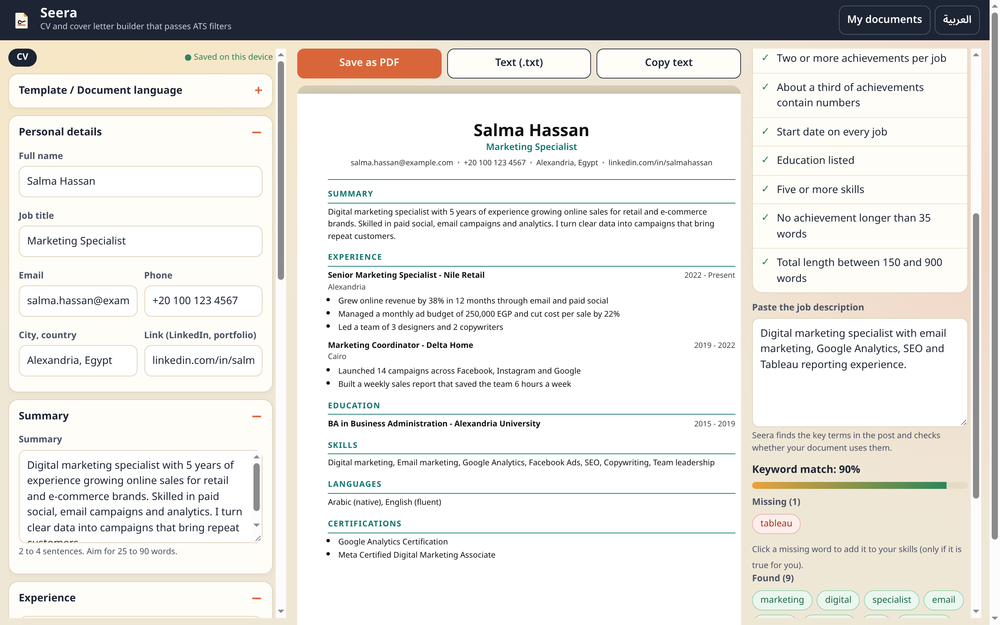
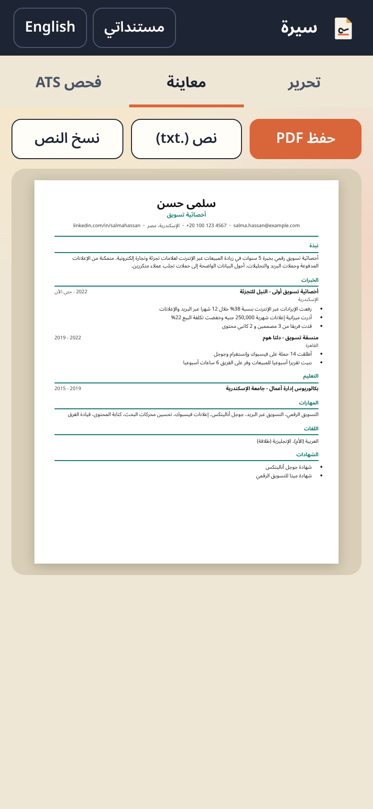
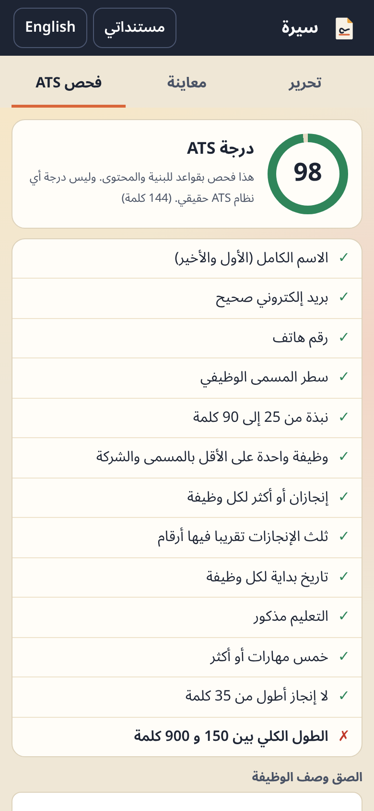
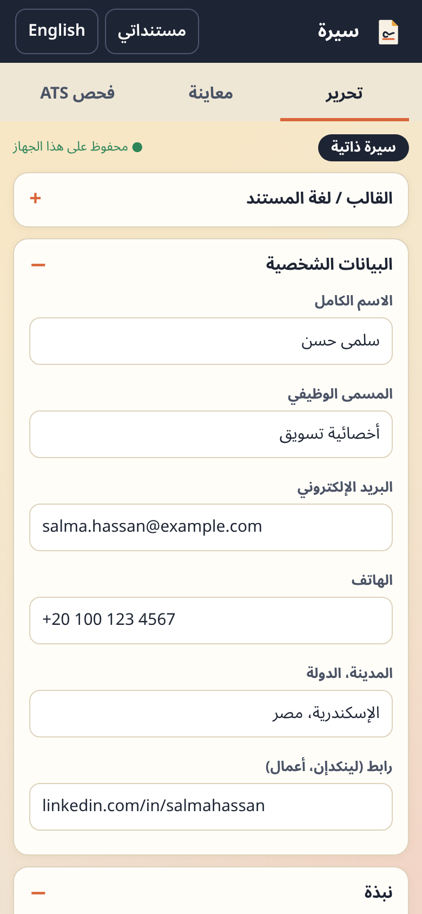

<p align="center"></p>
<h1 align="center">Seera | سيرة</h1>
<p align="center"><b>Build a CV and cover letter that applicant tracking systems can read. Arabic and English. Free PDF. No account.</b></p>
<p align="center"><a href="https://yousefkhames.github.io/seera/">Open the live app</a></p>



## Pitch

Most CV builders put your text in columns, icons and images that ATS software reads badly, and many charge for the PDF. Seera keeps one clean column of real text, checks it against concrete rules, compares it with the job post you paste, and exports a PDF at no cost. The interface and the documents both work in Arabic (RTL) and English, and they switch independently.

## Features

- CV editor: personal details, summary, experience, education, skills, languages, certifications. Add, remove and reorder jobs.
- Cover letter writer: tone (formal, friendly, direct), strengths, years, a draft generator, and free editing of the final text. Copies your details from your CV.
- Three single-column templates (Classic, Modern, Compact), six accent colors, sans or serif, three text sizes.
- ATS check: 13 weighted rules (name, valid email, phone, summary length, dated jobs, achievements with numbers, skills count, and more) with a live score.
- Job match: paste a job post, see which key terms your document has and which it lacks, and add a missing term to your skills with one tap.
- Arabic and English everywhere: UI language and document language are separate. Arabic-Indic digits are understood by the checks.
- Export: PDF (browser print to PDF, real selectable text), plain text, JSON backup and restore.
- Several documents, duplicate and delete. Everything is autosaved in your browser.
- Mobile first, works offline after the first load, keyboard friendly.

## Screenshots

| Arabic preview | Arabic ATS check | Arabic editor |
|---|---|---|
|  |  |  |

## Tech

Plain HTML, CSS and JavaScript. No framework, no build step, no server, no tracking, no network calls. State lives in `localStorage`. The logic (`core.js`) is pure and runs in Node for tests.

```
index.html  styles.css  app.js  core.js  i18n.js  logo.svg
test/       core.test.js (29 unit tests)  browser.test.js  pdf.test.js  run.sh
```

## Run and test

```
python3 -m http.server 8000      # then open http://localhost:8000
sh test/run.sh                    # needs node 22 and google-chrome
```

The browser tests drive headless Chrome over the DevTools protocol at 390px and 1400px widths: editing, live preview, add/reorder/remove, scoring, job match, persistence, RTL, letter generation, document management, and a PDF text-layer check.

## Honest limits

- The ATS score is a rule-based check made by this app. It is not the output of any real ATS and cannot promise you will pass one.
- PDF export uses the browser print dialog. Choose "Save as PDF" and turn off headers and footers. Output varies slightly between browsers.
- Arabic PDF text is real text, but some ATS parsers and text extractors split Arabic letter ligatures (for example lam-alef). Keep a plain `.txt` or Word-compatible copy if an employer portal asks for one.
- The cover letter "generator" fills templates with your answers. It is not AI and it will not invent facts, so a short draft is expected. Edit it.
- Keyword matching uses simple word stems for English and a light prefix strip for Arabic. It misses synonyms and multi-word phrases.
- Data lives only in this browser. Clearing site data deletes it, so export a JSON backup now and then.
- No photo field, on purpose.

## License

MIT, see [LICENSE](LICENSE).
